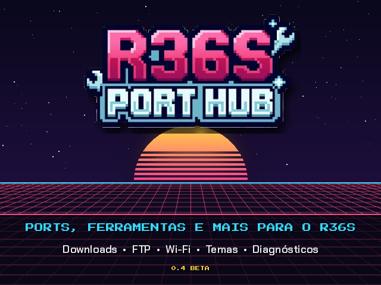
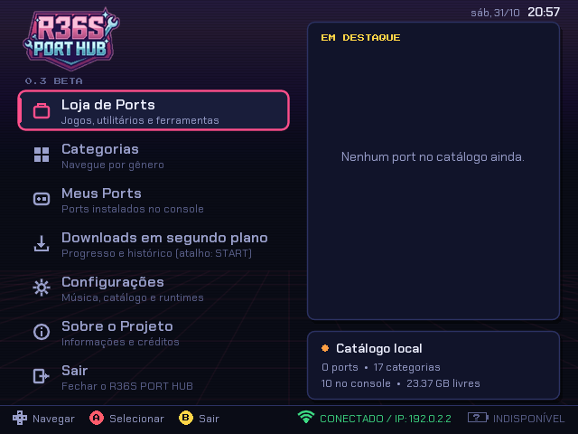
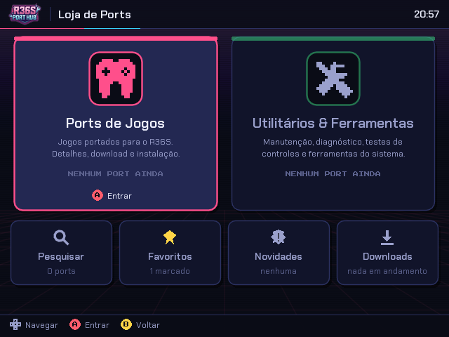
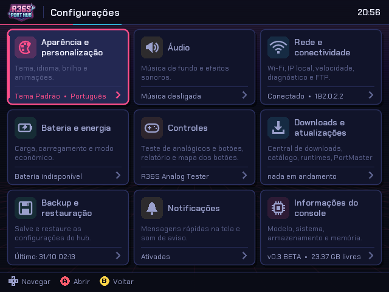
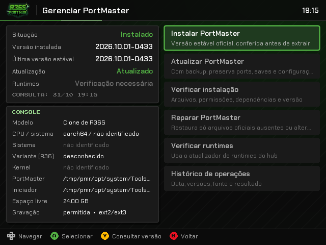
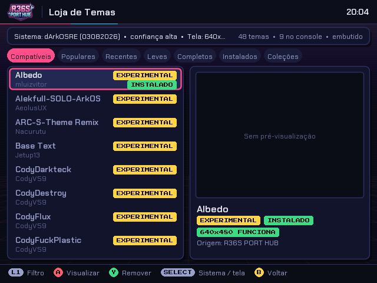

<p align="center">
  
</p>

<h1 align="center">🎮 R36S PORT HUB</h1>

<p align="center">
  <b>Central de ports, ferramentas e temas para o console R36S</b><br>
  Feito pela comunidade, para a comunidade.
</p>

<p align="center">
  
  
  
  
  
</p>

> ⚠️ **Versão BETA.** As funções foram testadas em simulador no computador. Algumas ainda precisam ser confirmadas no console de verdade — relatos e correções são bem-vindos.

---

## 💡 Sobre o projeto

O **R36S PORT HUB** é um aplicativo para o console portátil **R36S** que reúne, numa única tela, tudo o que normalmente exige computador, cartão fora do console e vários tutoriais: baixar e instalar ports de jogos, instalar BIOS de emuladores, gerenciar o PortMaster, trocar temas, cuidar do cartão microSD, testar os controles e conectar o Wi-Fi.

Ele roda direto no console, com os botões físicos, em uma interface retrô feita para a tela de 640×480. Tudo o que mexe no cartão é conferido antes (tamanho, hash, caminhos) e, quando substitui algo, faz backup e consegue voltar atrás se der errado.

O catálogo de jogos e ferramentas fica online, então novos ports aparecem no hub sem precisar de uma versão nova do aplicativo.

Feito para o **dArkOSRE** (também funciona no dArkOS e no ArkOS), em **LÖVE 11.5**, com tradução para português, inglês e russo. Desenvolvido por **LagdoLira**.

---

## ⚖️ Aviso

O R36S PORT HUB é uma ferramenta de catálogo e instalação. Os jogos, ports, BIOS e demais arquivos de terceiros citados pertencem aos seus respectivos autores e **não fazem parte deste repositório**. O projeto não se responsabiliza pela criação, pelo conteúdo, pela disponibilidade ou pela distribuição desses arquivos — respeite as licenças e os direitos autorais de cada um.

---

## ⬇️ Downloads (link fixo)

Estes links **nunca mudam**: cada atualização substitui o arquivo por trás deles.

| O que é | Link direto |
|---|---|
| 🔄 **Atualização** (pacote incremental, o mais recente) | [`R36S-PORT-HUB-update.zip`](https://github.com/liralflsti-wq/r36s-port-hub/releases/latest/download/R36S-PORT-HUB-update.zip) |
| 📦 **Pacote completo** (instalação do zero) | [`R36S-PORT-HUB.zip`](https://github.com/liralflsti-wq/r36s-port-hub/releases/latest/download/R36S-PORT-HUB.zip) |
| 🧾 **Código-fonte** | [`R36S-PORT-HUB-codigo-fonte.zip`](https://github.com/liralflsti-wq/r36s-port-hub/releases/latest/download/R36S-PORT-HUB-codigo-fonte.zip) |
| 🖼️ **Catálogo de temas** (`temas.json`) | [`temas.json`](https://raw.githubusercontent.com/liralflsti-wq/r36s-port-hub/main/temas.json) |

Para usar com `curl` / `wget` no console:

```sh
# atualização (baixa o pacote mais recente para a pasta update)
wget -O /roms/ports/update/R36S-PORT-HUB-update.zip \
  https://github.com/liralflsti-wq/r36s-port-hub/releases/latest/download/R36S-PORT-HUB-update.zip

# apontar a Loja de Temas para o catálogo online (link fixo, uma linha só)
echo "https://raw.githubusercontent.com/liralflsti-wq/r36s-port-hub/main/temas.json" \
  > /roms/ports/r36sporthub/es_themes_url.txt

# apontar as atualizações do hub para este repositório
echo "https://raw.githubusercontent.com/liralflsti-wq/r36s-port-hub/main/update.json" \
  > /roms/ports/r36sporthub/update_url.txt
```

> O link de download do GitHub (`releases/latest/download/...`) redireciona para o arquivo da versão mais recente. No console, use `wget --content-disposition` se quiser que o nome do arquivo venha igual ao do anexo.

---

## 📸 Telas

| Menu principal | Central de Conteúdo | Configurações |
|:---:|:---:|:---:|
|  |  |  |

| Gerenciar PortMaster | Loja de Temas |
|:---:|:---:|
|  |  |

<sub>Capturas feitas no simulador de desenvolvimento (640×480), com dados de teste.</sub>

---

## ✨ O que o hub faz

| | Função | Resumo |
|---|---|---|
| 🛒 | **Central de Conteúdo** | Ports de Jogos, BIOS do Sistema e Ports Utilitários e Ferramentas em áreas separadas, com capa, descrição, tamanho, favoritos, pesquisa e novidades. |
| 🧩 | **BIOS do Sistema** | Baixa, identifica pelo MD5 (banco do libretro) e instala BIOS na pasta certa do dArkOSRE, com backup, restauração e limpeza dos arquivos de instalação. |
| ⬇️ | **Downloads em segundo plano** | Fila com progresso, velocidade e histórico reais. **START** abre a central de qualquer tela. |
| 📦 | **Instalação segura** | ZIP, RAR e 7z, conferidos antes de instalar (tamanho, md5/sha256, caminhos inseguros). Nenhum script baixado é executado. |
| 🧩 | **Verificador de compatibilidade** | Compara o que o port pede (arquitetura, sistema, runtimes, tela) com o console. |
| 🛠️ | **Gerenciar PortMaster** | Instala, atualiza, verifica e repara o PortMaster com a versão estável oficial, com backup e recuperação. |
| 📚 | **Runtimes** | Confere e atualiza os runtimes do PortMaster (md5 de cada arquivo). |
| 🎨 | **Temas do hub** | Tema Padrão e Tema Xbox, aplicados na hora. |
| 🖼️ | **Loja de Temas do EmulationStation** | Usa as fontes do ThemeMaster (galeria OGA e coleções do GitHub), escolhe tamanho de tela, reconhece os temas do console e mostra qual está ativo. |
| 📶 | **Wi-Fi** | Procura redes, conecta, mostra sinal e faz diagnóstico de rede e teste de velocidade. |
| 📁 | **FTP e gerenciador de arquivos** | Servidor FTP para copiar jogos pelo PC; gerenciador com extrair, recortar, colar e excluir. |
| 📡 | **Transmissão e gravação** | Veja a tela do hub ao vivo no navegador do PC (rede local) e grave vídeos da interface no cartão SD. |
| 🔄 | **Atualizações** | Atualização local (pacote ZIP/7Z/RAR na pasta `update`) ou via rede, com validação SHA-256, backup, histórico e volta automática se algo falhar. |
| 💾 | **microSD** | Analisador, verificador e otimizador do cartão, sem colocar os jogos em risco. |
| 🕹️ | **Testes de controles** | R36S Analog Tester integrado (analógicos e botões). |
| 🔍 | **Analisador de Console** | Identifica o modelo/clone do R36S pela placa, tela e controles. |
| ⏰ | **Data e hora** | Fuso horário, sincronização pela internet e ajuste manual. |
| 💡 | **R36 Control** | LED de bateria, gama, saída de áudio e volume ao ligar (mesmos ajustes do dArkOSRE). |
| 🧯 | **Registro de erros** | Erros e falhas ficam salvos em `r36sporthub/logs/`, sem senhas. |
| 🌐 | **Três idiomas** | Português do Brasil, English e Русский. |
| 🔠 | **Tamanho do texto** | Pequeno, Padrão, Grande ou Muito grande; o texto que não cabe se ajusta sozinho. |

---

## 🚀 Instalação no R36S

1. Baixe `R36S-PORT-HUB.zip` na página de **Releases** (ou use o [link fixo](https://github.com/liralflsti-wq/r36s-port-hub/releases/latest/download/R36S-PORT-HUB.zip)).
2. Copie o conteúdo para a pasta `ports` do cartão (`/roms/ports`, ou `/roms2/ports` com dois cartões):
   ```
   /roms/ports/R36S PORT HUB.sh
   /roms/ports/r36sporthub/
   ```
3. Reinicie o EmulationStation (ou o console). O hub aparece em **Ports**.
4. Conecte o Wi-Fi antes de baixar jogos.

**Requisitos:** PortMaster com o runtime `love_11.5`, `curl` ou `wget` e `unzip` (já vêm no dArkOS/dArkOSRE). Sem PortMaster, o hub tem a opção **Gerenciar PortMaster** para instalá-lo — mas para abrir o hub pela primeira vez é preciso o LÖVE do PortMaster (ou o `love` do sistema).

---

## 🎮 Controles

| Botão | Ação |
|---|---|
| ✚ Direcional | Navegar |
| 🅰️ **A** | Selecionar / confirmar |
| 🅱️ **B** | Voltar / cancelar |
| **X / Y** | Ações da tela (mostradas no rodapé) |
| **L1 / R1** | Trocar categoria ou página |
| **SELECT** | Favorito / escolhas da tela |
| **START** | Central de Downloads (de qualquer tela) |
| **FN** | Print da tela em `/roms/print` |

---

## 🌍 Catálogos online (atualizam sem nova versão do app)

| Catálogo | Arquivo no GitHub | Onde colocar o link no hub |
|---|---|---|
| 🎮 Ports de jogos e 🛠️ utilitários | `catalog.json` (catálogo online) | `r36sporthub/catalog_url.txt` ou `C.CATALOG_URL` |
| 🖼️ Temas do EmulationStation | `temas.json` | `r36sporthub/es_themes_url.txt` ou `C.ES_THEMES_URL` |
| 🎨 Temas do próprio hub | `themes.json` | `r36sporthub/themes_url.txt` ou `C.THEMES_CATALOG_URL` (*download ainda não ativo*) |
| 🔄 Atualização do hub | `update.json` (versão, link, SHA-256 e notas) | `r36sporthub/update_url.txt` ou `C.UPDATE_URL` |

📄 Passo a passo completo: **[GUIA_GITHUB_CATALOGOS.txt](GUIA_GITHUB_CATALOGOS.txt)**.

---

## 📖 Documentação

| Documento | Conteúdo |
|---|---|
| [docs/MANUAL.md](docs/MANUAL.md) | Manual completo de todas as telas e funções |
| [docs/CATALOGO.md](docs/CATALOGO.md) | Formato do catálogo de ports |
| [docs/LOJA_TEMAS.md](docs/LOJA_TEMAS.md) | Loja de Temas do EmulationStation e ThemeMaster |
| [docs/TEMAS.md](docs/TEMAS.md) | Como criar temas para o hub |
| [docs/IDIOMAS.md](docs/IDIOMAS.md) | Traduções |
| [docs/AJUSTES.md](docs/AJUSTES.md) | Histórico de mudanças |

---

## 🗂️ Estrutura do projeto

```
port/        launcher "R36S PORT HUB.sh" + pasta r36sporthub/ (binários, capa, licenças)
src/         código do app (LÖVE 11.5): core/, ui/, threads/, i18n/, lib/
catalogo-temas/   temas.json da Loja de Temas (para publicar no GitHub)
docs/        manual e documentação
tools/       build.sh (gera o pacote) e scripts de apoio
tests/       testes
```

Gerar o pacote: `tools/build.sh` → `build/R36S-PORT-HUB-BETA.zip`.

---

## 🙏 Créditos e licenças

- Fontes **Press Start 2P**, **Chakra Petch** e **Inter**: SIL Open Font License.
- **LÖVE**: licença zlib. **7-Zip**: licença em `port/r36sporthub/licenses/`.
- **PortMaster**, **ThemeMaster**, **dArkOS/dArkOSRE** e a **Emulationstation-OGA-Theme-Gallery** pertencem aos seus autores; o hub apenas usa as fontes públicas deles.
- Os jogos e ports listados pertencem aos seus respectivos autores.

<p align="center">💜 Feito pela comunidade, para a comunidade!</p>
